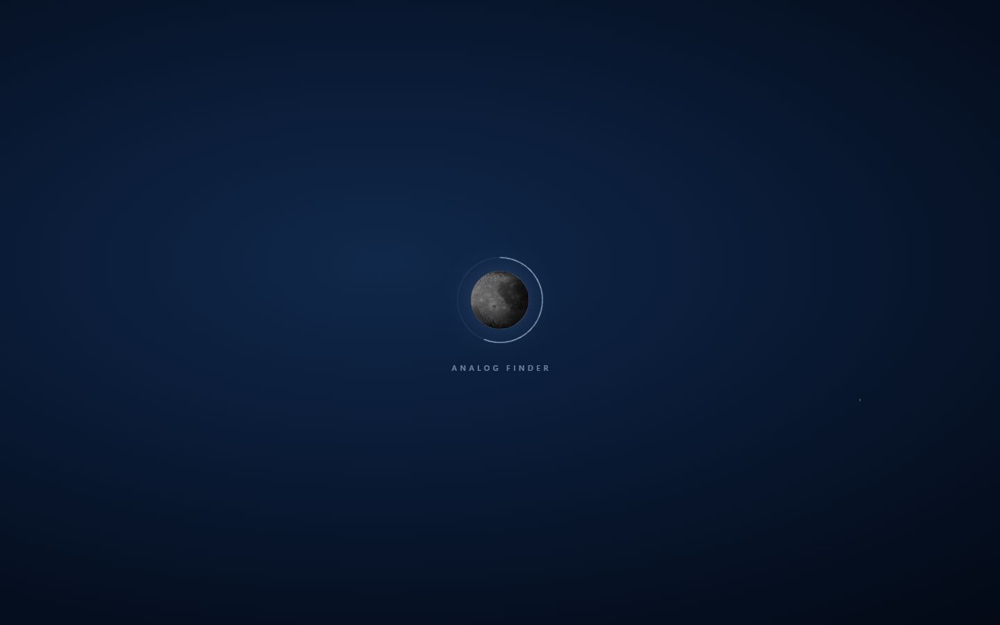
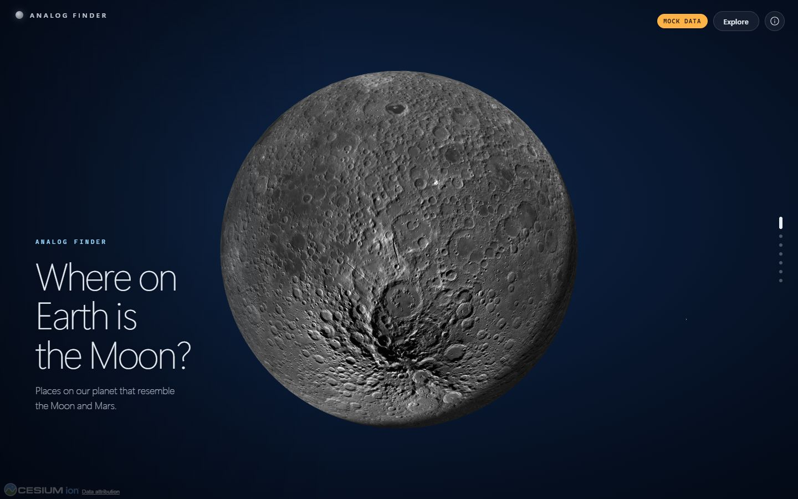
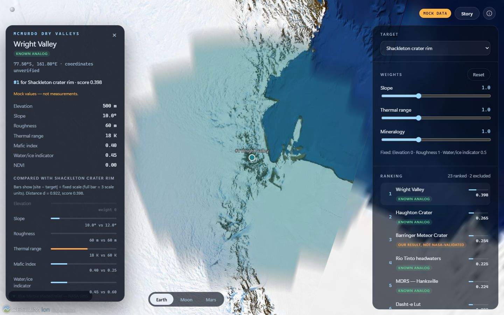

# Analog Finder

**Where on Earth is there a place that resembles a given lunar or Martian site?**
A NASA Space Apps 2026 project: an offline Python pipeline turns open NASA / space-agency data into
small contract files, and a static CesiumJS web app lets you explore Earth analogs for Moon and
Mars targets, in a guided **Story mode** or a hands-on **Explore mode**.

> **Status: v1 runs on MOCK data.** The model and the real data pipeline are being built by the
> data team. Until they land, the app uses a clearly labelled mock set (`public/data/mock/`, a
> "Mock data" badge on screen, `"mock": true` in every file). Swapping in real output needs no
> code changes; see [Going real](#going-real).

| Preloader | Story | Explore |
| --- | --- | --- |
|  |  |  |

**Design.** Cinematic and minimal, after `vid-reference/01` (kept locally, git-ignored): deep-navy
space, a sunlit globe with soft camera-following light, a glass "scan" ring sweeping the Earth, and
almost no text. There is no nav bar, just a wordmark, the data badge, an Explore/Story toggle and a
Methods icon. A space **preloader** turns a small real Moon (LRO WAC, 35 KB) while the data set
and the 3D engine load, then lifts the Moon off the top as the content appears. The app itself (globe,
story, camera flights, observers) is only constructed after the preloader has completely finished.
The engine is a separate chunk, so the first paint only needs about 46 KB of gzipped JS.

- Architecture and plan: [docs/ARCHITECTURE.md](docs/ARCHITECTURE.md)
- Data contract (schemas, units, similarity formula, ownership): [CLAUDE.md](CLAUDE.md)
- Local toolchain: [tools/README.md](tools/README.md) · Raw data: [data/raw/README.md](data/raw/README.md)

## Setup

Requirements: **Node.js ≥ 20** on PATH (tested 22.23), internet for the first setup. Nothing else:
Python 3.11, its packages and the Playwright browser are installed **inside `tools/`**.

```bash
npm run setup          # creates tools/, installs uv + CPython 3.11 + venv + npm deps + Chromium, prints versions
```

Re-running it is safe. Windows uses `tools/scripts/setup.ps1`, macOS/Linux `tools/scripts/setup.sh`.

## Run

```bash
npm run dev            # http://localhost:5173  (mock data by default)
npm run build          # type-check + static build into dist/
npm run preview        # serve dist/ on http://localhost:4173
```

Append `?data=mock` or `?data=real` to the URL to override the data source at runtime.

## Mock mode (default)

```bash
npm run mock:generate               # rebuild public/data/mock/ from pipeline/mock/sites.toml (deterministic)
npm run validate:data               # validate it with the browser's validator (TypeScript)
npm run pipeline:validate           # validate it with the pipeline's validator (Python)
npm run pipeline:validation-report  # where each known analog ranks per target
```

The mock set has 2 Moon targets, 2 Mars targets and 25 Earth candidates, including the known
analogs (Atacama, Haughton, Mauna Kea, Iceland, San Francisco Volcanic Field, Dry Valleys, Rio
Tinto, MDRS) and two vegetated sites that the NDVI filter excludes. Values are hand-picked to be
physically plausible, and they are **not measurements**.

## Going real

1. The data team writes contract files (see [CLAUDE.md](CLAUDE.md)) into `public/data/` with `"mock": false`.
2. Validate: `npm run validate:data -- public/data` (and/or `npm run pipeline:validate -- public/data`).
3. Switch: `VITE_DATA_SOURCE=real npm run build` (or change the default in `src/config/data-source.ts`).

If real files break the contract, the app shows every error (file + JSON path) and offers the mock
set instead. It never renders invalid data. The mock set stays in the repo for tests and as a demo
fallback. Expected raw inputs and how to obtain them: [data/raw/README.md](data/raw/README.md);
Earth Engine export template: `pipeline/earth_engine/export_earth_features.py`.

## Quality

```bash
npm run verify         # typecheck + ESLint/Prettier + vitest + contract validation + pytest + mypy + build
npm run test:e2e       # Playwright smoke: load, switch Earth/Moon/Mars, move a slider, ranking changes
npm run screenshots    # regenerate docs/screenshots/*.jpg
npm run check:sources  # probe every tile endpoint / dataset page in src/config/sources.ts (OK/FAIL)
npm run fetch:basemaps # refresh the offline fallback tiles in public/basemaps/
```

## Deploy

- **GitHub Pages:** push to `main`. `.github/workflows/deploy.yml` runs setup and every check, builds
  with `BASE_PATH=/<repo>/` and publishes `dist/`. In the repo settings, set Pages → Source to
  "GitHub Actions".
- **Netlify:** connect the repo. `netlify.toml` builds with `npm run build` and publishes `dist/`.
- **Anywhere static:** `npm run build` and upload `dist/`. For a sub-path, build with
  `BASE_PATH=/sub/path/ npx vite build`.

No backend and no Cesium ion token are needed. Imagery comes straight from NASA Trek / GIBS. If a
tile server is unreachable, the app falls back to a bundled low-resolution copy, then to a
graticule, and says so in the status bar.

## Project layout

```text
CLAUDE.md            data contract (features, units, schemas, ownership)
schemas/             JSON Schema per contract file, shared by Python and TypeScript
data/raw/            raw downloads (git-ignored except README)
pipeline/            Python 3.11: contract/ (ranking, validators), mock/ (generator + specs),
                     validation.py, earth_engine/ (export template), tests/
public/data/mock/    mock contract files       public/data/  real output goes here
public/basemaps/     offline fallback tiles (real NASA imagery, levels 0-2)
src/                 TypeScript app: config/ (sources.ts, data-source.ts), contract/, data/ (loader,
                     validator), rank/, globe/ (Cesium), ui/, story/chapters.ts (all Story text)
tests/               vitest unit tests and Playwright e2e
tools/               local toolchain (only README and scripts/ are committed)
```

For three people working in parallel: data people own `pipeline/` and `public/data/`, the
interface person owns `src/`, and both sides meet only at `schemas/` + `CLAUDE.md`.

## Known limitations

- **Mock data only.** The ranks, heatmaps and validation results on screen demonstrate the
  mechanism, not real analog quality. The "discovery" chapter deliberately claims nothing in mock mode.
- **No real pipeline or model yet.** Feature extraction, fingerprints and the similarity export
  for real rasters are owned by the data team. The "AI and model" section of the architecture is
  intentionally empty.
- **Unverified inputs.** All target and known-analog coordinates are flagged `coords_verified: false`,
  and all feature-dataset names are `unverified` until checked at the source.
- **Heatmap vs sliders.** The similarity PNG is the pipeline result at default weights. The sliders
  re-rank the exported candidate pool live, but they do not recolour the heatmap.
- **Mock grid coverage.** Click popups have values only near candidates and targets (plus mock polar
  ice caps on the Moon and Mars). Elsewhere they say "no data".
- **Scientific scope.** Similarity covers terrain, thermal range, mineralogy and aridity, not
  gravity, radiation or vacuum. Mineral and ice values are cross-instrument proxies.
- **Bundle size.** CesiumJS is about 4.4 MB minified (about 1.2 MB gzipped) and is loaded up front.
  Data files are small: PNG overlays are 360×180 and grids are sparse.
- **Optional three.js site mesh** is not implemented in v1.
- **Responsive down to tablet** (about 768 px). Phones are not a target.
